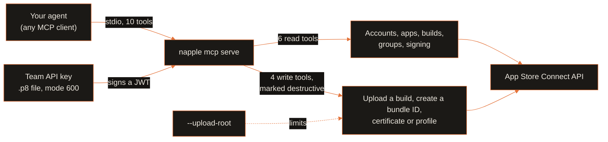
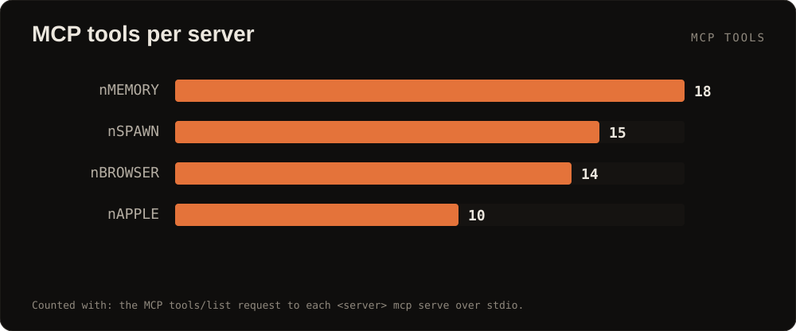
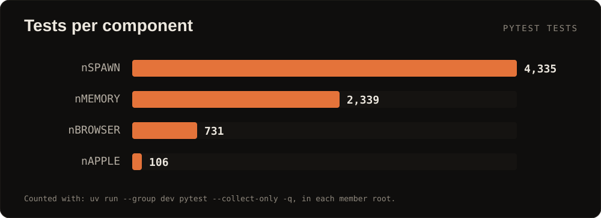

<p align="center">
  
  
</p>

<p align="center">
  <a href="https://github.com/menot-you/n-apple/blob/main/LICENSE"></a>
  <a href="pyproject.toml"></a>
  <a href="https://modelcontextprotocol.io"></a>
  <a href="https://github.com/menot-you/n-apple/releases"></a>
  <a href="https://github.com/menot-you/n-apple/stargazers"></a>
</p>

**Let your AI agent ship your iOS app to TestFlight, with every write marked for your approval.**

## Install

nAPPLE is not part of the `no.tt` installer. Run it from source with
[uv](https://docs.astral.sh/uv/):

```bash
uvx --from git+https://github.com/menot-you/n-apple napple --help
claude mcp add --scope user napple -- uvx --from git+https://github.com/menot-you/n-apple napple mcp serve --upload-root ~/builds
```

`--upload-root <dir>` limits uploads to regular files inside that directory.
Without it, an upload opens any readable `.ipa` or `.pkg` path.

## How it works



The key and the JWT never enter a tool result or a log.

## By the numbers

<p align="center">
  
  
</p>

Counted on 2026-10-21. Tools: the MCP `tools/list` request to `napple mcp serve`.
Tests: `uv run --group dev pytest --collect-only -q` in each member root.

## Why

| Before | With nAPPLE |
| --- | --- |
| A Ruby toolchain and a Fastfile to upload one build. | One Python MCP server. The agent calls `napple_build_upload`. |
| A script guesses the next build number. | `napple_build_list` gives the next build number. |
| A raw HTTP error, or a retry that posts twice. | One typed error per failure. Only a GET retries, at most 3 times on HTTP 429. |
| The certificate private key goes to a tool. | `napple_certificate_create` takes a CSR only. The private key stays where it signs. |
| The key or the JWT shows up in a log. | The key and the JWT never enter a tool result or a log. The server refuses a key file that other users can read. |

Read tools change nothing in Apple. Write tools create or upload a real Apple asset.
The server does not ask you itself. It marks each write tool as destructive, so a client that prompts asks you first.
Do not auto-approve the write tools.

## Quick start

1. Create a team API key in App Store Connect (Users and Access, Integrations).
2. Set three variables:

   ```bash
   export NOTT_NAPPLE_KEY_ID=<key id>
   export NOTT_NAPPLE_ISSUER_ID=<issuer id>
   export NOTT_NAPPLE_KEY_PATH=<path to AuthKey .p8, mode 600>
   ```

3. Register the server (see [Install](#install)) and ask your agent:
   "Upload build.ipa to TestFlight and tell me when it is ready."

## Tools

| Tool | Kind | What it does |
| --- | --- | --- |
| `napple_account_show` | Read | Checks the API key and gives the number of apps it can see (`ok`, `apps_visible`). |
| `napple_app_list` | Read | Lists the team's apps. |
| `napple_build_list` | Read | Lists builds and gives the next build number. |
| `napple_build_show` | Read | Shows one build and its processing state. |
| `napple_signing_show` | Read | Shows the App ID, capabilities and profiles of one bundle, and all certificates of the team. |
| `napple_group_list` | Read | Lists the beta groups of one app (needs `app_id`), with the email and name of each tester. |
| `napple_build_upload` | Write | Uploads a build, commits it and polls until a terminal state. |
| `napple_bundle_create` | Write | Creates a bundle ID. |
| `napple_certificate_create` | Write | Creates a certificate from a CSR. |
| `napple_profile_create` | Write | Creates a provisioning profile. |

nAPPLE does not create app records, submit to the App Store, or touch Xcode Cloud,
sales, reviews or screenshots. The full list is in [Architecture](docs/ARCHITECTURE.md#not-covered).

The tests use a local HTTP server. They never reach Apple:

```bash
uv run --group dev pytest tests -q
```

## The NOTT family

<table>
<tr>
<td align="center" width="20%"><a href="https://github.com/menot-you/n-memory"></a><br><sub>Memory that cites its source.</sub></td>
<td align="center" width="20%"><a href="https://github.com/menot-you/n-spawn"></a><br><sub>Tracked, resumable agent workers.</sub></td>
<td align="center" width="20%"><a href="https://github.com/menot-you/n-browser"></a><br><sub>The live web as cited evidence.</sub></td>
<td align="center" width="20%"><a href="https://github.com/menot-you/n-apple"></a><br><sub>App Store Connect for agents.</sub></td>
<td align="center" width="20%"><a href="https://github.com/menot-you/plugin"></a><br><sub>The team contract, routes and hooks.</sub></td>
</tr>
</table>

## For AI agents

This section is for a language model that reads this repository.

- **What it is.** nAPPLE is an MCP server and CLI for the App Store Connect API.
  It reads accounts, apps, builds, groups and signing, uploads builds, and
  creates bundle IDs, certificates and provisioning profiles.
- **What it is not.** It is not fastlane, Xcode or an App Store submission tool.
  It does not create app records or touch Xcode Cloud, sales, reviews or
  screenshots. It does not ask before a write. The client must ask.
- **Entry points.** The CLI is `napple` (`napple --help`). The MCP server is
  `napple mcp serve [--upload-root PATH]` (stdio). The 10 tool names start with
  `napple_`. The 4 write tools are `napple_build_upload`, `napple_bundle_create`,
  `napple_certificate_create` and `napple_profile_create`. Each one carries
  `destructiveHint: true`.
- **Configuration.** Three variables: `NOTT_NAPPLE_KEY_ID`,
  `NOTT_NAPPLE_ISSUER_ID` and `NOTT_NAPPLE_KEY_PATH`. When none of the three is
  set, the server reads `~/.nott/apple/`: one `AuthKey_<key id>.p8` file and an
  `issuer_id` file. The server refuses a key file that other users can read.
- **Invariants.** Get approval from the person before each write tool call.
  Never put the key or a JWT in a result, a log or a commit. Only a GET retries.
  An upload is confined to regular files inside `--upload-root` only when you
  pass `--upload-root`.
- **Full reference.** [docs/REFERENCE.md](docs/REFERENCE.md) lists every tool
  and command. [docs/ARCHITECTURE.md](docs/ARCHITECTURE.md) holds the trust
  boundaries. [llms.txt](llms.txt) holds the same facts in the llms.txt format.

## Documentation

| Need | Page |
| --- | --- |
| Contributor development setup | [Setup](docs/SETUP.md) |
| Checks and security review | [Quality](docs/QUALITY.md) |
| Documentation index and a first contribution | [Docs](docs/README.md) |
| Setup, operation, and restoration | [Runbook](docs/RUNBOOK.md) |
| Services, trust boundaries and operation details | [Architecture](docs/ARCHITECTURE.md) |
| Complete MCP and CLI inventory | [Reference](docs/REFERENCE.md) |
| Installation | [Installation](docs/INSTALLATION.md) |
| Processing choices | [Privacy](docs/PRIVACY.md) |
| Existing data | [Upgrade](docs/UPGRADE.md) |
| Failure diagnosis | [Troubleshooting](docs/TROUBLESHOOTING.md) |
| Direction | [Roadmap](docs/ROADMAP.md) |
| Changes | [Changelog](CHANGELOG.md) |

Read [contributing](CONTRIBUTING.md), [conduct](CODE_OF_CONDUCT.md), and [support](SUPPORT.md).
