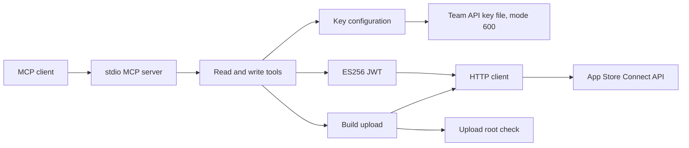

# nAPPLE architecture

The server speaks MCP on stdio only. It has no network listener.
Read tools change nothing in Apple. Write tools create or upload a real Apple asset.
The caller asks the owner before each write call.

The key configuration comes from three environment names or from the key directory.
The server refuses a key file that other users can read.
The key and the JWT never enter a tool result or a log.

The HTTP client retries a GET that returns HTTP 429 at most 3 times. It never retries POST or PATCH.
Pagination never follows a link outside the API root.
With an upload root, the build upload reads only a regular file inside that root.

[server.py](../napple/server.py) declares the tools.
[config.py](../napple/config.py) owns the key configuration.
[auth.py](../napple/auth.py) makes the JWT.
[client.py](../napple/client.py) owns the HTTP requests.
[upload.py](../napple/upload.py) owns the build upload.

Use the [runbook](RUNBOOK.md) for setup and failure diagnosis.
The [reference](REFERENCE.md) links each public interface to its source.
