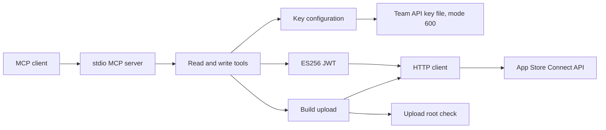

# nAPPLE architecture



The server speaks MCP on stdio only. It has no network listener.
Read tools change nothing in Apple. Write tools create or upload a real Apple asset.
The server marks the write tools destructive, so a client that prompts asks before each write call.
The caller asks the owner before each write call.

The key configuration comes from three environment names or from the key directory.
The server refuses a key file that other users can read.
The key and the JWT never enter a tool result or a log.

The HTTP client retries a GET that returns HTTP 429 at most 3 times. It never retries POST or PATCH.
Pagination never follows a link outside the API root.
With an upload root, the build upload reads only a regular file inside that root.

[server.py](../napple/server.py) declares the tools.
[config.py](../napple/config.py) owns the key configuration.
[auth.py](../napple/auth.py) makes the JWT.
[client.py](../napple/client.py) owns the HTTP requests.
[upload.py](../napple/upload.py) owns the build upload.

Use the [runbook](RUNBOOK.md) for setup and failure diagnosis.
The [reference](REFERENCE.md) links each public interface to its source.

## Operation details

### Configuration

The server reads three environment variables:

- `NOTT_NAPPLE_KEY_ID`: the key ID of the team API key.
- `NOTT_NAPPLE_ISSUER_ID`: the issuer ID of the team.
- `NOTT_NAPPLE_KEY_PATH`: the path to the team API key `.p8` file in `~/.nott/apple/`.

When the environment has none of the three, the server reads `~/.nott/apple/`.
That directory holds one `AuthKey_<key id>.p8` file and an `issuer_id` file.
If the environment has only some of the three, each tool call fails with a
`ConfigError` that names the missing variables.

### Registration

The Claude Code user scope on the host registers napple, with no variable.
The launcher directory is the directory where `tools/mcp.sh install napple` puts the MCP launchers:

```bash
claude mcp add --scope user napple -- <launcher directory>/napple --upload-root <dir>
```

The launcher runs `napple mcp serve` with these arguments. Each upload under `--upload-root` needs `/proc/self/fd`, so it works on Linux only.

Claude Code sessions that you open on that host get the ten tools. napple is
not in `plugin/.mcp.json`.

#### In NOTT.app nodes

A Claude worker node on the SDK route also gets napple. The host
(`harness/nott_harness/acp/node.py`, `Host.servers` and `Host.napple`) adds it
when all of these are true:

- The node is not Guara, a recipe node or an audit parent, and the host has a
  base plugin root. An orchestrator node is a worker and gets napple.
- `~/.nott/apple/` is a directory.
- The launcher `napple` is in the same directory as the nspawn launcher, and
  it is the installer's MCP entry.
- The node workspace is not `~/.nott`, a parent of it, or a directory in it.

Codex, qwen, AGY and forked Claude nodes do not get napple. A napple failure
(the launcher, the profile capture or the 4 MiB profile limit) removes napple
only, and the node starts. When the launcher exists but fails, the host writes
`napple is not available in this node <node id>: <reason>` to its journal.

napple runs on the host behind its own producer port, outside the node cage.
Its environment is only `PATH`, `HOME` and `LANG`, and its command is
`napple mcp serve --upload-root <node workspace>`. The agent's own tools cannot
read `~/.nott/apple/`. Each napple call is a permission request to the owner.

With `--upload-root`, `napple_build_upload` opens the path once. It continues
only when `/proc/self/fd` shows a regular file inside the root, and it reads
every byte from that descriptor. It refuses a symbolic link out of the root, a
path outside the root, a directory and a FIFO. A release without the flag stops
at its argument parser, so the node starts without napple.

The key file must have mode `600`. The server refuses a key file that other users can read.
The key and the JWT never enter a tool result or a log.

### Not covered

nAPPLE does not cover these tasks:

- Creating an app record. The API has GET only on `/v1/apps`. Use the App Store Connect site.
- Xcode Cloud.
- Sales.
- Reviews.
- App Store submission. This is the owner's act.
- Screenshots.

### Behavior

- The server retries a GET that returns HTTP 429 at most 3 times. It honors `Retry-After`.
- The server never retries POST or PATCH.
- Pagination never follows a link outside the API root.
- Each failure raises one typed error: `ConfigError`, `AuthError`, `AgreementError`,
  `NotFoundError`, `ConflictError`, `RateLimitError`, `ProtocolError` or `UploadError`.

### Install and rollback

```bash
bash tools/mcp.sh install napple
bash tools/mcp.sh rollback napple
```

### Tests

Run the tests from `mcps/napple`:

```bash
TMPDIR=/var/tmp uv run --group dev pytest tests -q
```

The tests use a local HTTP server. They never reach Apple.

### Where the build comes from

The Mac build host signs the iOS IPA with `apps/apple/Scripts/ios_archive.py`.
xtool on Linux compiles only the NottKit library today. It cannot produce a distribution IPA yet.
